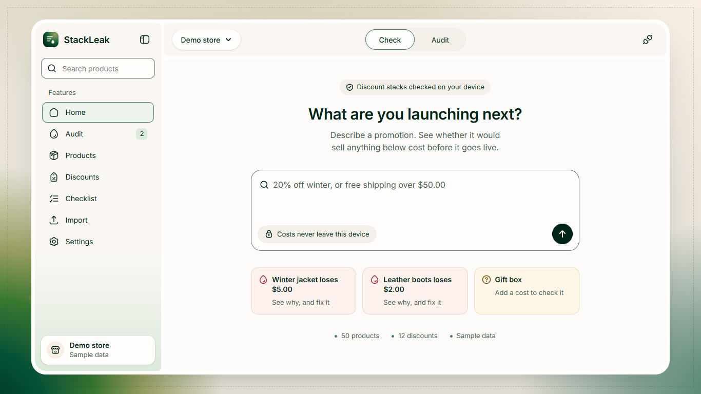

# StackLeak

Find the discount stack that sells below cost, before your customers do. (Working name.)



## Try it

Requires Node 22.16 or later.

```bash
npm ci
npm start              # builds, then serves http://localhost:4173
```

It opens on a synthetic sample store, with no account, key or upload. Add `?demo` to the URL for a copy that never saves.

1. Select **Winter jacket loses $5.00** to see the receipt, the reason each pair combines, and the Relate query.
2. Select **Preview fix**, then **Add to checklist**.
3. Go **Home** and type `70% off winter` to check a promotion before it exists.

## Use case

Each promotion in a store can be profitable alone. A 20% product discount, a 15% welcome code and free shipping together turn a $100 jacket that costs $65 into a $60 sale. StackLeak is for merchants and agencies who need to find those stacks before a sale goes live.

The relationships that matter are which discounts reach which products, and which pairs of discounts allow each other. A stack is possible only when **every** pair in it combines, so this is a search for fully connected groups.


## How it uses Relate

- **Mode:** directory for the committed store and the MCP server. The browser uses Relate WASM with OPFS.
- **Why this mode:** a directory lets agents read while something else writes. On Windows a single `.rl` file could not be read by a second process during writes. OPFS keeps a merchant's costs on their own device.
- **What the graph models:**

```text
(Variant)-[:IN]->(Collection)
(Discount)-[:APPLIES_TO]->(Variant | Collection)
(Discount)-[:ALLOWS]->(Class)
(Discount)-[:HAS_TAG | ACCEPTS_TAG]->(Tag)
(Discount)-[:COMBINES_WITH {key, rule}]->(Discount)
```

| Relate does | Where it shows |
|---|---|
| Derives each compatible pair, storing the reason on the edge | "Why can these be used together?" |
| Grows fully connected groups by intersecting neighbors | Every audit |
| Follows collections to the products a discount reaches | Every audit |
| Finds which pairs each settings change would cut | "How to fix it", with side effects |
| Audits a scratch copy of the graph | Promotion check |
| Persists in the browser and on disk | Saved audits, demo store, MCP |

Money is calculated with exact integers outside Cypher. All Cypher is in [queries.ts](packages/core/src/queries.ts).

## Use it from an AI agent

A read-only MCP server exposes five tools: `audit_store`, `check_variant`, `explain_leak`, `simulate_settings` and `check_promotion`.

```bash
claude mcp add discount-audit -- node --experimental-strip-types apps/mcp/server.ts demo/store
```

Then ask: *What sells below cost, and how do I fix it?*

For your own audit, choose **Back up** in the app, then:

```bash
npm run store:import -- audit-backup.json data/store
```

Point the server at `data/store`.

## Where the data lives

- [`demo/store`](demo/store) is a persistent Relate directory store with 50 synthetic variants and 12 discounts. Inspect it with `npm run demo:audit`. `.gitattributes` marks it binary, because Relate cannot open it if Git rewrites its line endings.
- The browser app saves to two OPFS stores on the device. A save finishes in the idle one before switching, so an interrupted save loses nothing.

## Develop

```bash
npm run dev            # dev server
npm test               # both engines, an independent evaluator, features, clone, MCP
npm run typecheck
npm run build && npm run test:e2e    # real browser (Edge on Windows, Chrome elsewhere)
```

```text
apps/web        React app and the Relate WASM worker
apps/mcp        read-only MCP server
packages/core   rules, Cypher, money, fixes, import, report
docs/           design, specs, plan
```

Native Relate (tests, `demo:audit`, MCP) on Linux needs glibc 2.39 or later, such as Ubuntu 24.04 or Debian 13. The browser app has no such requirement.

## Limits

- The rules follow Shopify's developer documentation and one vendor guide. They are **not yet verified against a real checkout**, and there is no Shopify connection yet.
- One product per cart. Taxes, payment fees, markets, segments, Functions and Buy X Get Y are not modeled. Unsupported discounts show as "Can't be sure".
- Searches stop at eight discounts in a stack and say so.
- Tested in Edge and Chrome on Windows. Other browsers are untested.

## Built with

Relate (native, WASM, OPFS), React, Vite, MCP TypeScript SDK, Zod, Hugeicons free icons, Inter and Geist Mono, Playwright and axe-core for testing.

Design, code, tests and documentation were written with significant help from Claude (Claude Code), including a separately written reference evaluator for differential testing.

## License

Code is [MIT](LICENSE). Images in `docs/design/inspiration` are third-party references and are not covered by that license.

StackLeak is not affiliated with or endorsed by Neo4j or Shopify.
