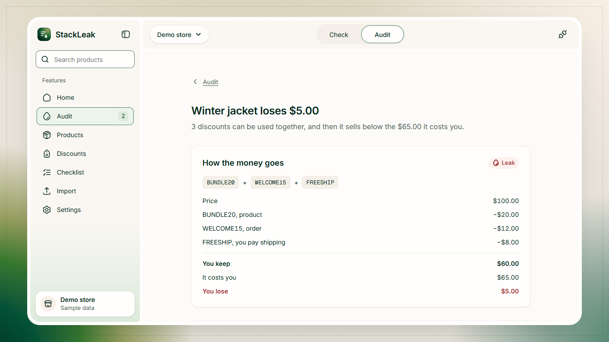

# Plinth

Find the discount stack that sells below cost, before your customers do.


## Try it

**Live:** the app is at [plinth.amit-ksh.workers.dev/app/](https://plinth.amit-ksh.workers.dev/app/), and the landing page at [plinth.amit-ksh.workers.dev](https://plinth.amit-ksh.workers.dev). Everything runs in your browser on a synthetic sample store.

To run it locally, you need Node 22.16 or later.

```bash
npm ci
npm start              # builds, then serves http://localhost:4173 (landing) and /app/ (the app)
```

The app opens on a synthetic sample store, with no account, key or upload. Add `?demo` to the URL for a copy that never saves.

1. On the **Dashboard**, the loss chart shows **Winter jacket** losing $5.00. Select it to see the receipt, the reason each pair combines, and the Relate query.
2. Select **Preview fix**, then **Add to checklist**.
3. Under **Discounts**, select **Add discount**, pick **Clearance**, set it to Winter and save: the leak guard stops it and names the jacket.
4. Give a discount a start and last day, then open **Calendar** to see its leak on those days only.
5. On the **Dashboard**, type `70% off winter` to check a promotion before it exists.

## Manage discounts

Plinth is where discounts are planned, created and changed, with a leak check in front of every save.

| Screen | What you do there |
|---|---|
| **Discounts** | Every discount with what it takes off, what it reaches, what it combines with, how many leaks it's in, and whether it's active, scheduled or ended |
| **Add a discount** | Start from a template (sitewide sale, collection sale, welcome code, VIP extra, spend more and save, free shipping, clearance), each with combination settings chosen so it can't stack into a loss by itself, or start from scratch |
| **Leak guard** | Before any save, the change is audited in a scratch graph. If it would sell anything below cost, Plinth names the products and the stacks; you change it or save anyway |
| **Calendar** | The next six weeks: which discounts are live each day and how many products lose money on each stretch, with a scheduled sale's leaks shown only on its days |
| **History** | Every change with the full discount before and after, where it was saved, and a rollback for the latest change to each discount |
| **Guardrails** | A minimum margin for the store and per collection, checked on every save. Warn mode lets you save anyway; Block mode refuses the save in the engine, not just on screen |
| **Pause all** | Ends every live discount at once, in Shopify too when linked, as one batch that **Resume all** puts back exactly as it was |
| **Unique codes** | Up to 1,000 random codes for a code discount, downloaded as CSV and added to the discount in Shopify when linked |
| **Watch for changes** | Shopify webhooks tell the Worker when a discount, product or cost changes outside Plinth. The app shows the change, re-reads the store on request and says whether anything new leaks. Optional Slack alerts |

When the audit is linked to a Shopify store, saves, ends, deletes and rollbacks are written to Shopify first, and only recorded locally if Shopify accepts them. Otherwise they change this audit only.

## Desktop app

[`apps/desktop`](apps/desktop) wraps the same app in a native window with [Tauri](https://tauri.app), so it looks and works exactly like the web version. The Windows installer is a few megabytes plus the 7 MB graph engine, instead of a bundled browser.

It adds one thing a browser can't: an **agent folder**. Under **Connect an AI agent**, choose a folder, and Plinth writes `plinth-audit.json` there after every change. Point the MCP server at that file and your agent always reads the latest audit:

```bash
claude mcp add plinth -- node --experimental-strip-types apps/mcp/server.ts "C:/Users/you/Documents/plinth-audit.json"
```

The web view can write only that one file, in the folder chosen in a native dialog; it has no other file system access. Shopify sign-in stays on the web app; bring a store to the desktop with **Back up** and **Restore**.

```bash
npm run build -w @app/desktop      # needs Rust; writes the installer to apps/desktop/src-tauri/target/release/bundle/
```

## Connect a Shopify store

On the live app, open **Import**, enter the store address and select **Connect Shopify**. Shopify asks for access to read products and inventory costs and to manage discounts. The Worker in [`apps/web/worker`](apps/web/worker) checks Shopify's signature and a one-time state cookie, trades the code for a short-lived online token, reads the store and hands the mapped data to the browser. The token is kept only in an encrypted, HttpOnly cookie that expires with it; the Worker stores nothing. Discount writes go through a fixed set of mutations in [`packages/core/src/shopify-write.ts`](packages/core/src/shopify-write.ts), checked against a real store with `npm run shopify:check-writes`.

For agencies and AI agents, the same reader runs from the command line and writes a directory store for the MCP server:

```bash
SHOPIFY_STORE=my-shop SHOPIFY_TOKEN=shpat_... npm run shopify:import -- data/my-shop
npm run mcp -- data/my-shop
```

The token needs `read_products`, `read_discounts` and `read_inventory` (the hosted app asks for `write_discounts` instead of `read_discounts`, so it can save changes). The mapping is in [`packages/core/src/shopify.ts`](packages/core/src/shopify.ts) and is tested against data read from a real Plus development store. Buy X Get Y, minimum-quantity and app discounts import as "Can't be sure". Gift cards are skipped. Customer eligibility is ignored, so every discount is assumed available to every buyer.

Installing on stores outside the developer's Shopify organization needs the app's distribution set in the Shopify Dev Dashboard, and App Store review for a public listing.

## Use case

Each promotion in a store can be profitable alone. A 20% product discount, a 15% welcome code and free shipping together turn a $100 jacket that costs $65 into a $60 sale. Plinth is for merchants and agencies who need to find those stacks before a sale goes live.

The relationships that matter are which discounts reach which products, and which pairs of discounts allow each other. A stack is possible only when **every** pair in it combines, so this is a search for fully connected groups.



## How it uses Relate

- **Mode:** directory for the committed store and the MCP server. The browser uses Relate WASM with OPFS.
- **Why this mode:** a directory lets agents read while something else writes. On Windows a single `.rl` file could not be read by a second process during writes. OPFS keeps a merchant's costs on their own device.
- **What the graph models:**

```text
(Variant)-[:IN]->(Collection)
(Discount)-[:APPLIES_TO]->(Variant | Collection)
(Discount)-[:ALLOWS]->(Class)
(Discount)-[:HAS_TAG | ACCEPTS_TAG]->(Tag)
(Discount)-[:COMBINES_WITH {key, rule}]->(Discount)
```

| Relate does | Where it shows |
|---|---|
| Derives each compatible pair, storing the reason on the edge | "Why can these be used together?" |
| Grows fully connected groups by intersecting neighbors | Every audit |
| Follows collections to the products a discount reaches | Every audit |
| Finds which pairs each settings change would cut | "How to fix it", with side effects |
| Audits a scratch copy of the graph | Promotion check |
| Persists in the browser and on disk | Saved audits, demo store, MCP |

Money is calculated with exact integers outside Cypher. All Cypher is in [queries.ts](packages/core/src/queries.ts).

## Use it from an AI agent

A read-only MCP server exposes five tools: `audit_store`, `check_variant`, `explain_leak`, `simulate_settings` and `check_promotion`.

```bash
claude mcp add discount-audit -- node --experimental-strip-types apps/mcp/server.ts demo/store
```

Then ask: *What sells below cost, and how do I fix it?*

For your own audit, choose **Back up** in the app, then:

```bash
npm run store:import -- audit-backup.json data/store
```

Point the server at `data/store`.

## Where the data lives

- [`demo/store`](demo/store) is a persistent Relate directory store with 50 synthetic variants and 12 discounts. Inspect it with `npm run demo:audit`. `.gitattributes` marks it binary, because Relate cannot open it if Git rewrites its line endings.
- Store data from Shopify passes through the Worker in memory and is never stored there. The access token lives only in an encrypted HttpOnly cookie that expires with it.
- Discount history (each change, before and after) and guardrails are saved with the audit in the browser and in backups.
- Cloudflare KV keeps, per connected store, the last 100 change notices from Shopify webhooks (discount titles, product titles, SKUs; never costs or prices) and the Slack URL if alerts are on. Removing the app from the store clears both.
- The browser app saves to two OPFS stores on the device. A save finishes in the idle one before switching, so an interrupted save loses nothing.

## Develop

```bash
npm run dev            # dev server
npm test               # both engines, an independent evaluator, features, clone, MCP
npm run typecheck
npm run build && npm run test:e2e    # real browser (Edge on Windows, Chrome elsewhere)
E2E_URL=https://plinth.amit-ksh.workers.dev/ npm run test:e2e   # same checks against the live copy (site root; the app is under /app/)
npm run deploy         # build and publish to Cloudflare (needs wrangler login)
```

```text
apps/web        React app and the Relate WASM worker
apps/mcp        read-only MCP server
packages/core   rules, Cypher, money, fixes, import, report
docs/           design, specs, plan
```

Native Relate (tests, `demo:audit`, MCP) on Linux needs glibc 2.39 or later, such as Ubuntu 24.04 or Debian 13. The browser app has no such requirement.

## Limits

- The pricing and combination rules match a real Shopify Plus development store on 13 carts, including both demo leaks (`packages/core/test/shopify-golden.ts`). Still unverified: shipping thresholds at checkout, several order discounts together, mixed fixed and percent discounts on one line, and stores without Plus. Plinth changes discounts in Shopify only when you save one; it never changes products, prices or costs.
- One product per cart. Taxes, payment fees, markets, segments, Functions, minimum quantities and Buy X Get Y are not modeled. Unsupported discounts show as "Can't be sure".
- Searches stop at eight discounts in a stack and say so.
- Tested in Edge and Chrome on Windows. Other browsers are untested.

## Built with

Relate (native, WASM, OPFS), React, Vite, MCP TypeScript SDK, Zod, Hugeicons free icons, Inter and Geist Mono, Playwright and axe-core for testing.

Design, code, tests and documentation were written with significant help from Claude (Claude Code), including a separately written reference evaluator for differential testing.

## License

Code is [MIT](LICENSE).

Plinth is not affiliated with or endorsed by Neo4j or Shopify.
