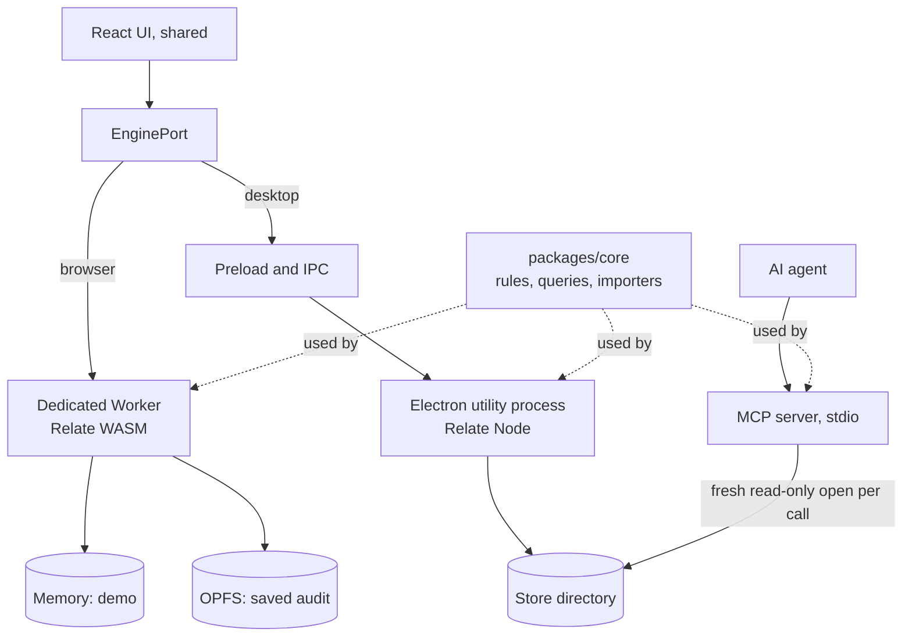
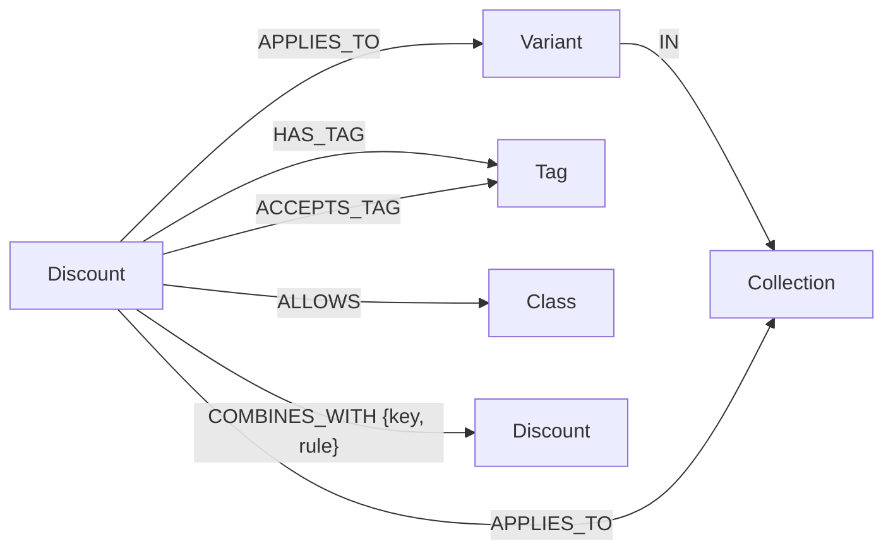

# 01 System design

Labels: **Tested** ran on 2026-11-22. **Documented** comes from Shopify developer docs. **Reported** comes from a vendor guide. **To verify** has neither run nor been confirmed.

## 1. Goal

1. Which discount groups can apply together and sell a variant below cost?
2. Why can each pair in that group combine?
3. What is the smallest settings change that closes the leak, and which intended offers does it break?

## 2. Domain rules

| # | Rule | Basis |
|---|---|---|
| D1 | Discounts have product, order or shipping classes | [Documented](https://shopify.dev/docs/apps/build/discounts) |
| D2 | `combinesWith` declares which classes a discount combines with | [Documented](https://shopify.dev/docs/api/admin-graphql/latest/objects/DiscountCombinesWith) |
| D3 | Several product discounts share a line only if every pair has a two-way tag match | Documented, same page |
| D4 | Same-line product stacking needs Shopify Plus | [Reported](https://promly.app/blog/shopify-discount-codes-vs-automatic-discounts/) |
| D5 | Two shipping discounts never combine | Reported |
| D6 | Product applies first, then order on the reduced subtotal, then shipping | Reported |
| D7 | Several order percentages each use the same subtotal | Reported |
| D8 | At most 5 product or order codes plus 1 shipping code, and 25 active automatic discounts | Reported |
| D9 | Order with order: the guide says automatic, the API has an explicit flag. Follow the flag | To verify |
| D10 | Order of several product discounts, mixed fixed and percent, and rounding | To verify |
| D11 | Buy X Get Y stacks only on the "get" items | Documented, not modeled in v1 |

Rules live in one versioned module. Each has a golden test taken from a development-store checkout.

## 3. Architecture



Cost and margin data never leaves the device. 

Repository layout:

```text
apps/
  web/            React, Vite, worker adapter
  desktop/        Electron main, preload, engine process
  mcp/            read-only stdio server
packages/
  core/           types, rules, importers, Cypher, EnginePort
  ui/             board, proof, simulator, import
demo/
  store/          committed Relate directory store for judges
docs/
```

## 4. Graph model



| Node | Properties |
|---|---|
| Variant | id, title, sku, price, cost (integer minor units) |
| Collection | id, title |
| Discount | id, title, class, method, pct, off, all_variants, min_subtotal, starts, ends, supported |
| EndedDiscount | Same. The separate label keeps it out of every audit |
| Tag, Class | id |

`HAS_TAG`, `ACCEPTS_TAG` and `ALLOWS` are source settings. `COMBINES_WITH` is derived: one edge per compatible pair, from lower ID to higher ID, when class, tag and date rules all allow it. Pairwise date overlap is sufficient, because intervals that all overlap in pairs share a common moment.

Because edges follow ID order, each fully connected group appears as exactly one sorted path.

### Invariants that prevent a false "Clear"

1. Missing cost is Unknown, never zero.
2. Any applicable Function, Buy X Get Y or otherwise unsupported discount makes the variant Unknown unless a leak is already proven.
3. A group beyond the eight-discount search bound reports "search incomplete".
4. Every pair in a group must combine. A connected chain is insufficient.
5. Derived edges rebuild with the settings that produced them, as one validated import.
6. A variant priced below cost with no discount is checked separately.

## 5. Verdicts

| State | Condition |
|---|---|
| Leak | A modeled group nets below cost |
| Thin | Above cost but below the chosen margin floor |
| Unknown | Missing or unsupported input, or incomplete search |
| Clear in model | None of the above |

The modeled cart holds one variant, quantity 1 to `max_qty`. Free shipping costs the merchant a configured amount. Taxes, payment fees, markets, segments and mixed carts are outside v1.

## 6. Query contract

### Q1 Leaks (tested on 3 variants and 6 discounts, native and WASM)

```cypher
MATCH (v:Variant)
MATCH p = (first:Discount)-[:COMBINES_WITH*0..7]->(:Discount)
WITH v, nodes(p) AS ds
WHERE ALL(d IN ds WHERE d.all_variants OR EXISTS { MATCH (d)-[:APPLIES_TO]->()<-[:IN*0..1]-(v) })
  AND ALL(i IN range(0, size(ds)-1) WHERE ALL(j IN range(0, size(ds)-1) WHERE
    j <= i OR EXISTS {
      WITH ds[i] AS a, ds[j] AS b
      MATCH (a)-[c:COMBINES_WITH]->(b) WHERE NOT c.key IN $removed
    }))
  AND size([d IN ds WHERE d.method = 'code' AND d.class <> 'shipping']) <= 5
UNWIND range(1, $max_qty) AS q
WITH v, ds, q, toFloat(v.price * q) AS listed
WITH v, ds, q, listed,
  reduce(t = listed, d IN [x IN ds WHERE x.class = 'product'] | t * (1 - d.pct / 100.0) - d.off * q) AS sub
WHERE ALL(d IN ds WHERE d.min_subtotal <= CASE WHEN d.class = 'product' THEN listed ELSE sub END)
WITH v, ds, q,
  sub - reduce(t = 0.0, d IN [x IN ds WHERE x.class = 'order'] | t + sub * d.pct / 100.0 + d.off)
      - CASE WHEN ANY(d IN ds WHERE d.class = 'shipping') THEN $shipping_cost ELSE 0 END AS net
WHERE net < v.cost * q
RETURN v.id AS variant, q AS qty, [d IN ds | d.id] AS stack, round(net) AS net, v.cost * q AS cost
ORDER BY net - cost, variant, qty
```

What the run showed:

- Jacket: three discounts, $60 net against $65 cost. Removing one pair clears it.
- Boots: two tagged product discounts, $60 against $62.
- A third Boots discount compatible with only one of the two was correctly excluded.

The arithmetic encodes D6, D7 and an assumed answer to D10. It is not proven equal to Shopify checkout.

### Q2 Explain a pair (to verify)

```cypher
MATCH (a:Discount)-[c:COMBINES_WITH]-(b:Discount)
WHERE a.id IN $stack AND b.id IN $stack AND a.id < b.id
RETURN a.title AS left, b.title AS right, c.rule AS why
```

### Q3 Fix candidates (to verify)

For each discount in a leaking group, candidates are: untick one class, remove one accepted tag, or end the discount.

1. Query the edge keys that setting creates.
2. Re-run Q1 with them in `$removed`. Ending a discount also needs a `$disabled` filter on `ds`, so single-discount leaks clear.
3. Rank by leaks cleared, then fewest non-leaking combinations broken, then fewest settings changed.

Shopify has no "disable this pair" switch, so every suggested fix must map to a real setting.

### Q4 Search completeness (to verify)

Return any variant with a fully connected applicable group of nine discounts and mark it Unknown.

### Scaling constraint

Q1 expands groups once per variant and will grow combinatorially. Twenty mutually compatible store-wide discounts give 125,970 groups of size eight alone. The production query must enumerate valid groups once, join applicable variants second and deduplicate identical price, cost and scope profiles. Sprint 1 has a load gate for this.

## 7. Engine interface

```ts
type State = 'leak' | 'thin' | 'unknown' | 'clear_in_model';
interface Scenario { removed: string[]; disabled: string[]; maxQty: number; shippingCost: number; floorPct: number }

interface EnginePort {
  audit(s: Scenario): Promise<AuditResult>;
  explain(stack: string[]): Promise<PairRule[]>;
  fixes(leakId: string, s: Scenario): Promise<Fix[]>;
  execute(c: Command): Promise<CommandResult>;
  importFiles(files: InputFile[]): Promise<ImportResult>;
  exportAudit(): Promise<AuditFile>;
}
```

The UI never sends Cypher. What-if never writes.

## 8. Storage

| Surface | Mode | Behavior |
|---|---|---|
| Public demo | Memory, WASM | Synthetic store, resets on reload |
| Browser audit | OPFS, WASM | Persists, one tab at a time |
| Desktop | Directory, native | One writer in a restartable process |
| MCP | Directory, read-only | Fresh open on every call |
| Repository | Directory | Checkpointed, marked binary in Git |

Directory mode is used because a single-file store blocked a second reader during writes on Windows.

## 9. MCP tools

| Tool | Returns |
|---|---|
| `audit_store` | Counts, top leaks, unknowns |
| `explain_leak` | Arithmetic and pairwise rules |
| `simulate_settings` | Leaks closed and combinations broken |
| `check_variant` | State for one SKU |

All are read-only, with no arbitrary Cypher.

## 10. Security

- No credentials, customers or orders are imported.
- Web CSP uses `connect-src 'self'`.
- Electron has context isolation, a sandboxed renderer and validated IPC.
- Imported titles render as text and CSV exports escape formula prefixes.
- The repository and video use synthetic data.

## 11. Decisions

| ADR | Decision | Reason |
|---|---|---|
| 1 | Relate finds and proves groups | All-pairs compatibility is the core graph problem |
| 2 | Derived pair edge keeps its rule | Fast traversal with an explanation |
| 3 | Unknown over a guessed Clear | A false Clear costs real money |
| 4 | Files before OAuth | No app review or credentials for judges |
| 5 | Audit, not checkout enforcement | Enforcement is crowded and needs Functions |
| 6 | Electron with `--no-asar` | Tested packaging requirement |
| 7 | Browser is the fallback | Native Linux needs glibc 2.39+ |
