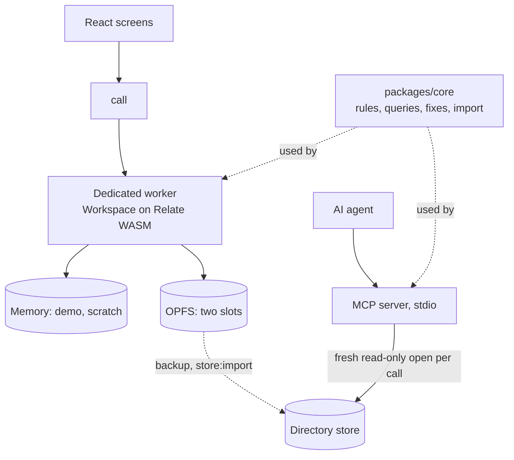
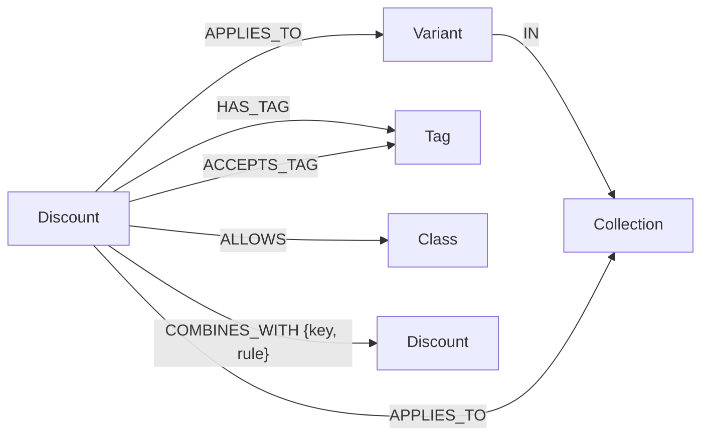

# 01 System design

Labels: **Tested** ran on 2026-11-22. **Shopify-tested** matched a Shopify Plus development store's cart pricing on 2026-11-23, recorded in `packages/core/test/shopify-golden.ts`. **Documented** comes from Shopify developer docs. **Reported** comes from a vendor guide. **To verify** has neither run nor been confirmed.

## 1. Goal

1. Which discount groups can apply together and sell a variant below cost?
2. Why can each pair in that group combine?
3. What is the smallest settings change that closes the leak, and which intended offers does it break?

## 2. Domain rules

| # | Rule | Basis |
|---|---|---|
| D1 | Discounts have product, order or shipping classes | [Documented](https://shopify.dev/docs/apps/build/discounts) |
| D2 | `combinesWith` declares which classes a discount combines with | [Documented](https://shopify.dev/docs/api/admin-graphql/latest/objects/DiscountCombinesWith) |
| D3 | Several product discounts share a line only if every pair has a two-way tag match | Shopify-tested |
| D4 | Same-line product stacking needs Shopify Plus | [Reported](https://promly.app/blog/shopify-discount-codes-vs-automatic-discounts/); works on Plus (Shopify-tested), non-Plus not tested |
| D5 | Two shipping discounts never combine | Reported |
| D6 | Product applies first, then order on the reduced subtotal, then shipping | Shopify-tested for product then order. Shipping thresholds not tested: carts don't price delivery |
| D7 | Several order percentages each use the same subtotal | Reported |
| D8 | At most 5 product or order codes plus 1 shipping code, and 25 active automatic discounts | Reported |
| D9 | Order with order: the guide says automatic, the API has an explicit flag. Follow the flag | To verify |
| D10 | Order of several product discounts, mixed fixed and percent, and rounding | Percentages on one line compound (Shopify-tested). Mixed fixed and percent on one line, and odd-cent rounding: to verify |
| D11 | Buy X Get Y stacks only on the "get" items | Documented, not modeled in v1 |

Rules live in one versioned module. Each has a golden test taken from a development-store checkout.

## 3. Architecture



Cost and margin data never leaves the device. 

Repository layout:

```text
apps/
  web/            React, Vite, worker
  mcp/            read-only stdio server
packages/
  core/           rules, Cypher, money, fixes, import, report
demo/
  store/          committed Relate directory store for judges
docs/
```

## 4. Graph model



| Node | Properties |
|---|---|
| Variant | id, title, sku, price, cost (integer minor units) |
| Collection | id, title |
| Discount | id, title, class, method, pct, off, all_variants, min_subtotal, starts, ends, supported |
| EndedDiscount | Same. The separate label keeps it out of every audit |
| Tag, Class | id |

`HAS_TAG`, `ACCEPTS_TAG` and `ALLOWS` are source settings. `COMBINES_WITH` is derived: one edge per compatible pair, from lower ID to higher ID, when class, tag and date rules all allow it. Pairwise date overlap is sufficient, because intervals that all overlap in pairs share a common moment.

Because edges follow ID order, each fully connected group appears as exactly one sorted path.

### Invariants that prevent a false "Clear"

1. Missing cost is Unknown, never zero.
2. Any applicable Function, Buy X Get Y or otherwise unsupported discount makes the variant Unknown unless a leak is already proven.
3. A group beyond the eight-discount search bound reports "search incomplete".
4. Every pair in a group must combine. A connected chain is insufficient.
5. Derived edges rebuild with the settings that produced them, as one validated import.
6. A variant priced below cost with no discount is checked separately.

## 5. Verdicts

| State | Condition |
|---|---|
| Leak | A modeled group nets below cost |
| Thin | Above cost but below the chosen margin floor |
| Unknown | Missing or unsupported input, or incomplete search |
| Clear in model | None of the above |

The modeled cart holds one variant, quantity 1 to `max_qty`. Free shipping costs the merchant a configured amount. Taxes, payment fees, markets, segments and mixed carts are outside v1.

## 6. Query contract

### Q1 Groups and leaks (implemented)

The source of truth is `packages/core/src/queries.ts`.

1. `DERIVE_PAIRS` writes one edge per compatible pair, with its rule.
2. `SCOPE` finds which discounts reach each variant. Variants with the same reach share one search.
3. `EXTEND_GROUPS` grows groups one discount at a time through common neighbors:

```cypher
UNWIND $groups AS row
UNWIND row.members AS member
MATCH (:Discount {id: member})-[c:COMBINES_WITH]->(next:Discount)
WHERE NOT c.key IN $removed AND next.id IN $profiles[row.profile]
WITH row.profile AS profile, row.members AS members, next.id AS added, count(c) AS linked
WHERE linked = size(members)
RETURN profile, members + [added] AS members
```

4. `money.ts` prices each group with exact integers. It is kept out of Cypher to avoid float rounding and to share results between variants with the same reach and price.

### Q2 Explain a pair (implemented)

```cypher
MATCH (a:Discount)-[c:COMBINES_WITH]-(b:Discount)
WHERE a.id IN $stack AND b.id IN $stack AND a.id < b.id
RETURN a.title AS left, b.title AS right, c.rule AS why
```

### Q3 Fix candidates (implemented)

For each discount in a leaking group the candidates are: untick one class, remove one accepted tag, or end the discount. `NEIGHBORS` returns the pairs each one cuts. A change clears a product exactly when it cuts every leaking group, because removing pairs can only remove groups. Ties go to the fewest profitable groups broken. When no single change clears a product, changes are combined into a plan.

Tests prove that each preview equals really changing the setting. Shopify has no "disable this pair" switch, so every fix maps to a real setting.

### Q4 Search completeness (implemented)

Return any variant with a fully connected applicable group of nine discounts and mark it Unknown.

### Scaling

Groups are enumerated once per distinct reach, with a cap of 25,000 per reach. Over the cap the result is Unknown. The load gate is 500 variants and 15 discounts in under 3 seconds in both engines.

## 7. Engine interface

`Workspace` in `packages/core/src/workspace.ts` is the whole application API. The screens reach an allow-list of its methods through the worker (`apps/web/src/protocol.ts`) and never send Cypher.

## 8. Storage

| Surface | Mode | Behavior |
|---|---|---|
| Browser audit | OPFS, WASM, two slots | A save builds the idle slot and marks it complete last. One tab at a time |
| `?demo` | Memory, WASM | Never saves |
| MCP | Directory, read-only | Fresh open on every call |
| Repository | Directory | Checkpointed, marked binary in Git |

Directory mode is used because a single-file store blocked a second reader during writes on Windows.

## 9. MCP tools

| Tool | Returns |
|---|---|
| `audit_store` | Counts, top leaks, unknowns |
| `explain_leak` | Arithmetic and pairwise rules |
| `simulate_settings` | Leaks closed and combinations broken |
| `check_variant` | State for matching products |
| `check_promotion` | What a promotion would break, before it exists |

All are read-only, with no arbitrary Cypher.

## 10. Security

- No credentials, customers or orders are imported.
- Web CSP uses `connect-src 'self'`.
- Imported titles render as text and CSV exports escape formula prefixes.
- The repository and video use synthetic data.

## 11. Decisions

| ADR | Decision | Reason |
|---|---|---|
| 1 | Relate finds and proves groups, TypeScript does the money | All-pairs compatibility is the graph problem. Money needs exact integers |
| 2 | Derived pair edge keeps its rule | Fast traversal with an explanation |
| 3 | Unknown over a guessed Clear | A false Clear costs real money |
| 4 | Files before OAuth | No app review or credentials for judges |
| 5 | Audit, not checkout enforcement | Enforcement is crowded and needs Functions |
| 6 | No desktop app for now | Scope decision. Browser and MCP cover the flows |
| 7 | Browser is the fallback | Native Linux needs glibc 2.39+ |
